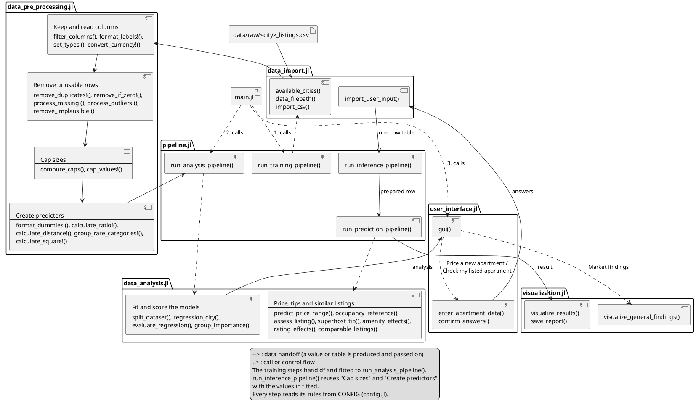
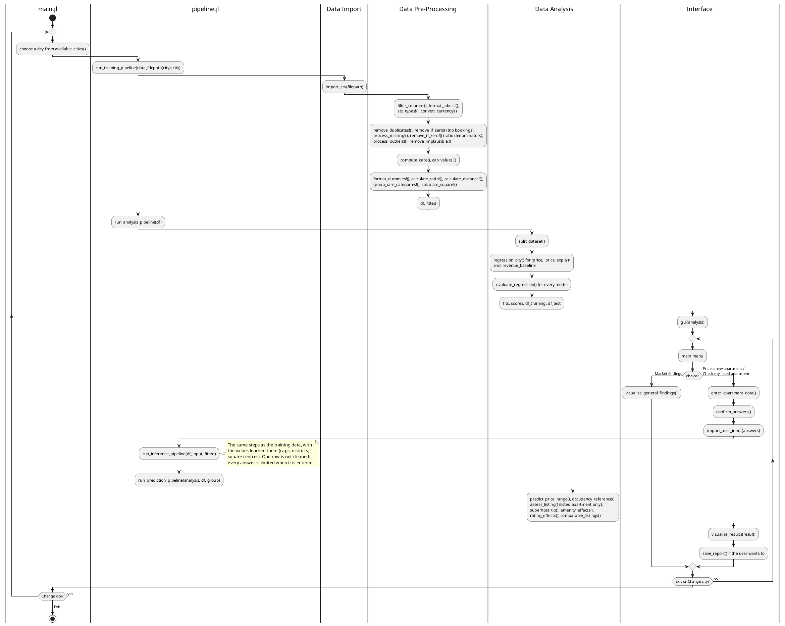

# Project design

HostWise estimates a fair nightly price and the expected yearly revenue of an apartment from the Inside Airbnb
listings of one city (https://insideairbnb.com/get-the-data/). The program runs in the terminal and works for
every city whose listings file is in `data/raw` and that has an entry in `CONFIG.cities` (currently Athens,
Barcelona and Madrid).

The program consists of the module file `Project1.jl`, a configuration, five functional components and `main.jl`:

1. Config (`config.jl`)
2. Data import (`data_import.jl`)
3. Data pre-processing (`data_pre_processing.jl`)
4. Data analysis (`data_analysis.jl`)
5. Pipelines (`pipeline.jl`)
6. Interface (`user_interface.jl` and `visualization.jl`)
7. Main (`main.jl`)

The listings file of the chosen city is imported (2), cleaned and transformed (3) and used to fit three
regression models (4). The pipelines (5) run these steps in a fixed order: one for the training data, one for the
analysis, one for the apartment of the user and one that collects every number of the result screen. The
interface (6) shows the market findings, asks the user about an apartment and shows the result. Every rule of
every step comes from the configuration (1), so a step can be changed or a city added without changing the code.
`main.jl` (7) starts the program. Every exported function has a docstring (shown in the Reference manual), and
the functions are tested in `test/runtests.jl` with the Test package.

In the following, each component is described with its functions, their input and their output.

(1) Config (`config.jl`) holds one constant named tuple `CONFIG` with every rule of the program: the columns that
are kept and their new names and types, the currency rules, the rules for duplicates, missing values, outliers,
implausible sizes and caps, the dummy, ratio, distance, district and square rules, the cities with their centre
and currency, the size of the test set and the seed of the split, the three regression models, the level of the
price range, the significance level of the tips, the amenities a host can add, the rating tips, the labels shown
on the screen and the limits of every question. `PROJECT_ROOT` is the folder of the project, so the data and the
saved result are found from every working directory.

(2) Data import (`data_import.jl`) reads the data:

- `import_csv()` takes the path of a listings file and returns its content as a DataFrame.
- `data_filepath()` builds the path of the listings file of a city, `data/raw/<city>_listings.csv` (city name in lowercase).
- `available_cities()` returns the cities of `CONFIG.cities` that have a listings file, so the city menu only offers cities that can be loaded.
- `import_user_input()` turns the answers of the user into a one-row DataFrame with the same column names as the listings.

(3) Data pre-processing (`data_pre_processing.jl`) cleans the listings and creates the predictors of the models.
Only `filter_columns()` returns a new DataFrame, so the imported table stays unchanged; every function whose name
ends with ! changes the given DataFrame in place. The functions:

*(3.1)* keep only the relevant columns and make them readable:

- `filter_columns()` keeps the columns of `CONFIG.relevant_columns`.
- `format_labels!()` renames the columns according to `CONFIG.label_mapping`.
- `set_types!()` sets the type of every column (with `convert_value()` for a single value, missing values stay missing).
- `convert_currency!()` converts every amount into euros with the rate of the city's currency (the prices of Athens, Barcelona and Madrid are already in euros).

*(3.2)* remove the rows that cannot be used:

- `remove_duplicates!()` removes listings that appear more than once.
- `remove_if_zero!()` removes rows with a zero in one of the given columns; it is used twice, for listings without bookings and for zeros in the denominator of a ratio.
- `process_missing!()` applies the missing-value rules from top to bottom: rows without price, revenue, Superhost status or rating are dropped, empty reviews per month become 0, missing bedrooms or beds of entire homes are dropped while other room types get the median of their room type (`impute_median_by_room_type!()`), and missing bathrooms are read from the bathroom text (`parse_bathrooms()`).
- `process_outliers!()` removes rows outside `Q1 - multiplier * IQR` to `Q3 + multiplier * IQR` in at least one checked column; skewed columns like the price are checked on the log scale.
- `remove_implausible!()` removes rows with impossible sizes, e.g. 50 bedrooms for 2 guests.

*(3.3)* limit the sizes to the values the models can describe:

- `compute_caps()` computes the upper limit of every size column for every room type, `cap_values!()` applies it.
- `input_bounds()` gives the smallest and largest value a user may enter for a question, from the same rules.

*(3.4)* create the predictors of the regression models:

- `format_dummies!()` turns the amenities and the Superhost status into 0/1 columns.
- `calculate_ratio!()` calculates a ratio of two columns, e.g. the occupancy rate (booked nights / 365).
- `calculate_distance!()` calculates the distance of every listing to the city centre in km.
- `kept_categories()` and `group_rare_categories!()` group districts with too few listings as `"_other"`.
- `square_center()` and `calculate_square!()` add the centred square of the guests and of the rating.

*(3.5)* translate the answers of the user:

- `get_amenity_columns()` and `selection_to_dummies()` turn the amenities ticked in the menu into 0/1 values.
- `derive_district()` finds the district of a location, the district of the nearest training listing.

(4) Data analysis (`data_analysis.jl`) fits and uses the regression models:

- `split_dataset()` splits the listings into a training set and a test set (`CONFIG.test_size`, reproducible with `CONFIG.split_seed`).
- `prepare_predictors()` and `prepare_dependent()` apply the log transformations of a model to its predictors and its target.
- `regression_city()` fits one linear model of `CONFIG.regression_models` with `GLM.jl`. There are three models: `:price` (the only model used for the price of a user's apartment), `:price_explain` (the rating sub-scores instead of the overall rating, used for the findings and the rating tips) and `:revenue_baseline` (for the findings only). `get_fit()` finds a fitted model by its name.
- `evaluate_regression()` scores a model on the test set (R² and the median and mean absolute error); `get_r2()` calculates the R².
- `group_importance()` measures how much each group of predictors adds to the fit of the price model.
- `predict_apartment_performance()` predicts the target of a model in euros; `predict_price_range()` predicts the typical price and the range in which `CONFIG.interval_level` (80 %) of comparable apartments lie.
- `occupancy_reference()` gives the typical occupancy of listings with the same district and room type; for a new apartment it gives the booked nights.
- `assess_listing()` compares the current price of a listed apartment with the predicted range (below, within or above).
- `significant_terms()`, `term_effects()`, `superhost_tip()`, `amenity_effects()` and `rating_effects()` turn the significant coefficients into effects in percent: the market findings and the tips to raise the price.
- `comparable_listings()` finds the five most similar listings in the training data.

(5) Pipelines (`pipeline.jl`) call the functions of (2) to (4) in a fixed order:

- `run_training_pipeline()` imports the listings file of a city and runs every pre-processing step. It returns the processed table `df` and `fitted`, the values learned from the training data (caps, kept districts, square centres and the city), which the apartment of the user needs as well.
- `run_analysis_pipeline()` splits the table, fits the three models and scores them. It returns `fits`, `scores`, `df_training` and `df_test`.
- `run_inference_pipeline()` prepares the one-row table of the user with the same steps and the values in `fitted` (caps, ratios, distance, district, squares) and checks that every predictor of the price model is there. A single row is not cleaned like the listings; instead every answer is limited when it is entered.
- `run_prediction_pipeline()` collects every number of the result screen for the prepared apartment: the price range, the booked nights, the revenue, for a listed apartment the assessment of its current price, the Superhost tip, the amenity and rating tips and the similar listings.

(6) Interface (`user_interface.jl` and `visualization.jl`) is a menu in the terminal:

- `gui()` shows the main menu until the user chooses Exit or Change city: Market findings, Price a new apartment, Check my listed apartment, Change city.
- `enter_apartment_data()` asks every question about the apartment (room type, sizes, location, amenities, Superhost, and for a listed apartment the current price, rating and booked nights) and returns the answers; `confirm_answers()` shows them once more before the prediction. The questions use `ask_choice()`, `ask_multiple()`, `ask_number()`, `ask_yes_no()`, `ask_location()`, `ask_numbers!()` and `get_room_type_options()`.
- `visualize_general_findings()` prints the market findings: the size and price level of the market, the price charts (`plot_price_distribution()`, `plot_price_by_room_type()`), what drives the price (`plot_group_importance()` and the effects of the amenities and ratings), how well the models predict (`plot_predicted_vs_actual()`) and the limits of the findings.
- `visualize_results()` prints the result screen of one apartment: the typical price and its range as a bar (`range_bar()`, `format_eur()`), the booked nights and the revenue, for a listed apartment the assessment of its current price, the tips to raise the price, the similar listings nearby and the limits. `save_report()` writes the same screen to `hostwise_result.txt`.

(7) Main (`main.jl`) contains only `main()`: it asks for the city, runs `run_training_pipeline()` and
`run_analysis_pipeline()` for it and passes the result to `gui()`. If the user chooses Change city, it starts again
with the city menu. Start the program with `julia src/main.jl`.

The interaction between the components and functions is shown in the following sections.

## Components

## Behaviour

## Limits of the results

The results describe comparable listings in the data. They are an orientation for a price, not a guarantee.

- **Booked nights are estimated.** Inside Airbnb estimates the booked nights of a listing from its reviews and caps them at 255 of 365 nights. The occupancy and the revenue are therefore estimates, not real bookings.

- **Listings, not bookings.** The price is the price a listing asks, not the price guests paid. The models describe what similar listings ask.

- **One random split.** The scores of the models come from one split into training and test set (20 % test, fixed seed). Another split gives slightly different values.

- **Only apartments like the listings.** The models are only reliable inside the range of the data, so every answer is limited to the values of comparable listings (caps per room type, plausibility rules, the area of the city).

- **Correlations, not causes.** The amenity, rating and Superhost effects are correlations: an amenity can be common in pricier places without raising the price itself. The tips show what similar listings with the feature ask.

- **One snapshot per city.** Each listings file is one snapshot of Inside Airbnb. Prices change with the season and over time, and the program has to be run again with a new file.

- **A district is taken from the nearest listing.** The location is entered as coordinates; the district is the district of the nearest training listing, and rare districts are grouped as "other districts".
